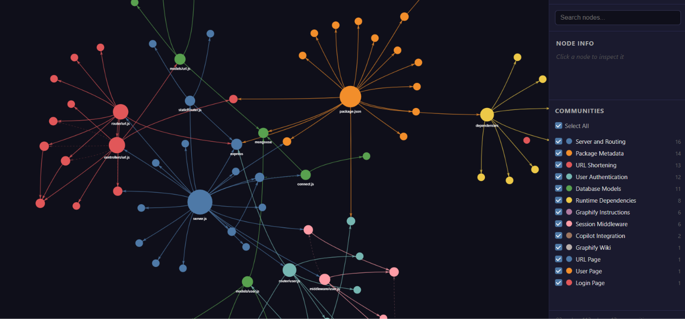

# URL Shortener

A small URL-shortening web app built with Node.js, Express, EJS, and MongoDB. Users can sign up, log in, create short links, see their links, and track how many times a link has been visited.

## Project graph

The image below is a Graphify-generated map of the project's code structure and relationships.



## Features

- User sign-up and login
- Create short links with generated short IDs
- View the signed-in user's links
- Redirect from a short link to its original URL
- Record visits and get a visit count from the analytics endpoint
- Render pages with EJS templates

## Tech stack

- Node.js and Express
- MongoDB with Mongoose
- EJS
- `nanoid` for short IDs
- `uuid` for session IDs
- `cookie-parser` for reading the session cookie

## Run locally

### Requirements

- Node.js and npm
- MongoDB running locally

### Start the app

1. Install dependencies:

   ```bash
   npm install
   ```

2. Start MongoDB. The app connects to `mongodb://localhost:27017/url-shorter`.

3. Start the server:

   ```bash
   node server.js
   ```

4. Open [http://localhost:3001](http://localhost:3001), then sign up or log in.

## Main routes

| Method | Path | Description |
| --- | --- | --- |
| `GET` | `/signup` | Show the sign-up page |
| `POST` | `/user/signup` | Create an account |
| `GET` | `/login` | Show the login page |
| `POST` | `/user/login` | Log in |
| `GET` | `/url` | List the signed-in user's links |
| `POST` | `/url` | Create a short link |
| `GET` | `/url/:shortId` | Redirect to the original URL |
| `GET` | `/url/analytics/:shortId` | Return the link's visit count as JSON |

## Project structure

```text
controllers/  Request handlers for URLs and users
middleware/   Authentication middleware
models/       Mongoose models for users and URLs
router/       Express route definitions
service/      In-memory session lookup
views/        EJS pages
public/       Static assets, including the project graph image
```

## Development note

This project is intended as a learning/demo app, not a production-ready authentication service. Sessions are stored in memory and are cleared when the server restarts. Passwords are currently stored without hashing. Before deploying publicly, use password hashing, persistent session storage, request validation, and environment-based configuration.

The `/url` routes, including generated `/url/:shortId` links and analytics, currently require a signed-in user. The server also defines a public `/:shortId` redirect route, but generated links use the authenticated `/url/:shortId` route.